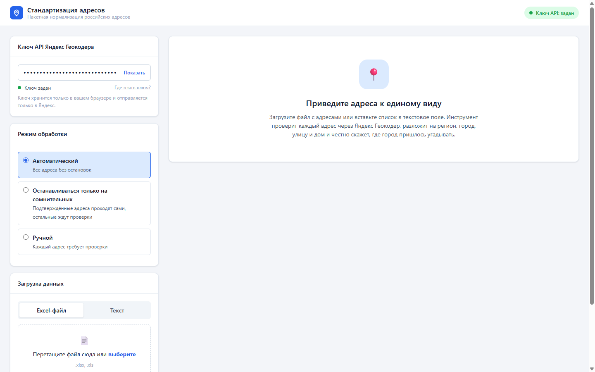
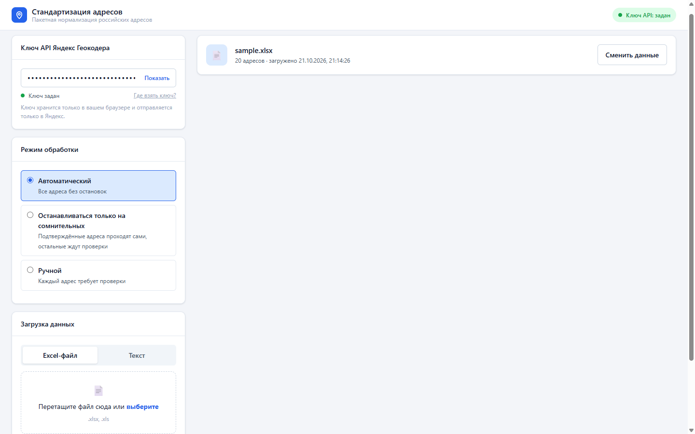
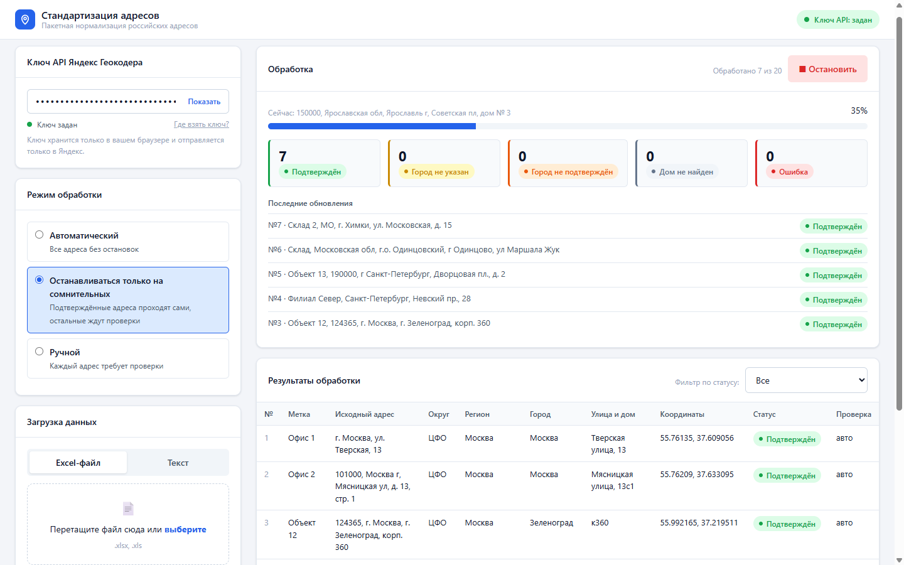
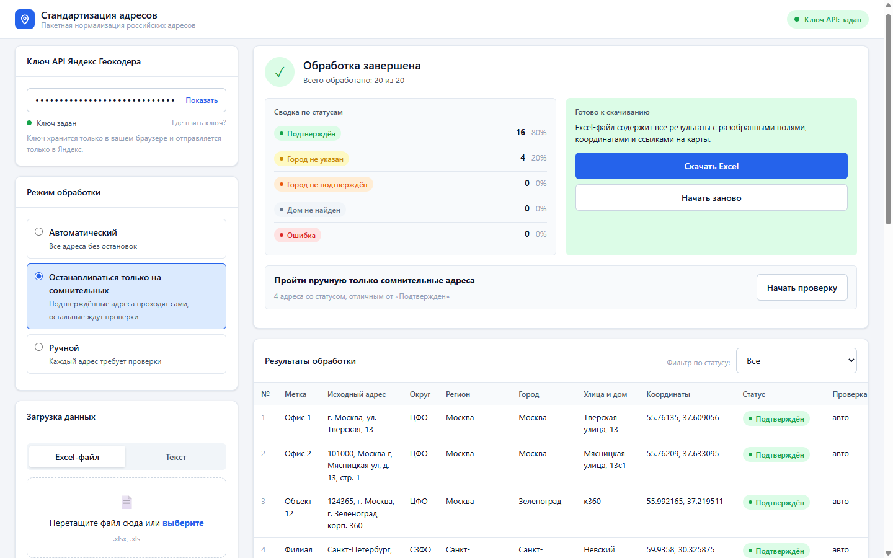

# Стандартизация адресов

> **EN.** A single-file, browser-only tool for batch normalization of Russian postal addresses. Load an Excel file or paste a list, run it through the Yandex Geocoder with your own API key, and get back an Excel file with parsed components, coordinates, map links and honest statuses. The key feature: it detects when the input address had no city and the geocoder silently picked one, instead of reporting such results as exact matches. The core is also published as a dependency-free npm package, `address-standardization-russia`, for browsers and Node, with a language-neutral algorithm description and test vectors for re-implementing it elsewhere.

Однофайловый инструмент для пакетной нормализации российских адресов. Работает целиком в браузере: без сервера, без установки, без передачи адресов кому-либо, кроме Яндекс Геокодера. Вы загружаете список «грязных» адресов и получаете Excel с регионом, населённым пунктом, улицей, домом, координатами и ссылками на карты.

**Демо:** https://mad8fat.github.io/address-standardization-russia/ (нужен свой ключ Яндекс Геокодера, см. ниже).



## Для кого

Для аналитика, логиста, менеджера по базе клиентов, которому нужно привести к единому виду от пятидесяти до нескольких тысяч адресов и не хочется ставить Python или покупать подписку. Инструмент сделан для нетехнического пользователя: один HTML-файл, понятные статусы, ручная проверка сомнительных адресов прямо в интерфейсе.

## Чем отличается от «просто геокодера»

Любой геокодер, включая Яндекс, это сопоставитель, а не проверяльщик. На строку «улица Ленина, 12» без города он честно вернёт дом 12 на улице Ленина в Кирове с точностью `exact`, потому что такой дом существует. Инструмент, который доверяет этому ответу, тихо подставит случайный город и пометит адрес как точный.

Этот инструмент так не делает. Он запрашивает у Яндекса до десяти кандидатов, проверяет, назван ли найденный населённый пункт в исходной строке, и считает, в скольких разных городах нашёлся такой адрес. Результат: четыре честных статуса вместо одного «точного», а угаданный город в выгрузку не попадает: для такого адреса колонка «Населённый пункт» остаётся пустой, а список городов-кандидатов идёт в отдельную колонку.

## Быстрый старт

1. Откройте [демо](https://mad8fat.github.io/address-standardization-russia/) или скачайте репозиторий (`index.html` вместе с папкой `vendor/`) и откройте `index.html` в браузере двойным кликом.
2. Вставьте ключ API Яндекс Геокодера в поле слева (как получить, ниже).
3. Загрузите Excel-файл или вставьте адреса текстом.
4. Нажмите «Начать обработку».
5. Скачайте Excel с результатами.

Для первого знакомства возьмите [examples/sample.xlsx](examples/sample.xlsx): 20 адресов известных публичных зданий в разных форматах записи, из них 4 без города.

## Как получить ключ Яндекс Геокодера

1. Зайдите в [Кабинет разработчика Яндекса](https://developer.tech.yandex.ru/services/) под своим Яндекс-аккаунтом.
2. Нажмите «Подключить API» и выберите **JavaScript API и HTTP Геокодер**.
3. Заполните короткую анкету. Для бесплатного тарифа нужно указать, что сервис будет использоваться в открытом доступе и некоммерчески.
4. После одобрения ключ появится в списке. Он выглядит как `xxxxxxxx-xxxx-xxxx-xxxx-xxxxxxxxxxxx`.
5. Вставьте ключ в поле «Ключ API Яндекс Геокодера». При включённой галочке «Запоминать ключ в этом браузере» он сохранится и будет подставляться автоматически при следующих открытиях страницы; без галочки его придётся вставлять заново в каждой новой вкладке.

**Про тариф.** Бесплатный тариф ограничен суточной квотой запросов и [условиями использования](https://yandex.ru/legal/maps_api/), в том числе требованием некоммерческого и открытого использования. Ответственность за соблюдение условий тарифа лежит на владельце ключа. Один адрес = один запрос. В кабинете разработчика ключ можно ограничить по HTTP Referer: тогда даже утёкший ключ не заработает с чужого сайта.

## Как подготовить файл

Excel-файл (`.xlsx` или `.xls`, до 10 МБ, до 10 000 адресов), первый лист:

| A: Адрес | B: Метка (необязательно) |
|---|---|
| г. Москва, ул. Тверская, 13 | Офис 1 |
| 150000, Ярославская обл, Ярославль г, Советская пл, дом № 3 | Объект 14 |
| улица Ленина, 12 | Склад |

Строку с заголовком можно оставить: если в первой непустой ячейке колонки A написано «Адрес», «Адреса» или «Адрес доставки», она будет пропущена. Пустые строки тоже пропускаются. Метка это любая подпись, которая вернётся в выгрузке рядом с адресом: название объекта, номер договора, что угодно.

Текстом: один адрес на строку, метка после табуляции.

## Как пользоваться



### Режимы обработки

- **Автоматический.** Все адреса обрабатываются без остановок. Подходит, когда данные в целом чистые, а сомнительные адреса удобнее разобрать потом.
- **Останавливаться только на сомнительных.** Подтверждённые адреса проходят сами, на каждом адресе с другим статусом открывается карточка проверки. Самый практичный режим.
- **Ручной.** Остановка на каждом адресе.

Пока идёт обработка, загрузить новые данные нельзя. Остановить обработку можно в любой момент кнопкой «Остановить» (она есть и на экране обработки, и в карточке проверки), а потом продолжить с того же места кнопкой «Продолжить обработку».

### Статусы

| Статус | Что значит | Что делать |
|---|---|---|
| **Подтверждён** | Найден дом, и населённый пункт (либо район или регион, если дом в них единственный) назван в исходной строке | Ничего, адрес готов |
| **Город не указан** | В исходной строке нет населённого пункта, и такая улица с домом нашлась в нескольких городах. Город в запись не записывается | Открыть карточку, выбрать нужный город из кандидатов |
| **Город не подтверждён** | Найден один вариант, но его город в исходной строке не назван; либо город назван, но одноимённых городов несколько, а регион не указан | Проверить глазами, тот ли это адрес |
| **Дом не найден** | Геокодер вернул только улицу, город или ничего | Поправить адрес вручную или оставить как есть |
| **Ошибка** | Сетевая ошибка или ошибка API после трёх попыток; причина видна при наведении на статус | Нажать «Повторить адреса с ошибкой» на экране завершения |

У подтверждённых адресов есть дополнительное поле **Точность**: «точный дом», «тот же номер, другой корпус», «ближайший дом», «приблизительно». Это значение `precision` из ответа Яндекса.


### Ручная проверка



В карточке видны исходная строка, статус с пояснением и список кандидатов. Клик по кандидату заполняет поля региона, города, улицы, дома и координат. Поля можно править руками, координаты принимаются в виде «55.7558, 37.6173» или «55,7558; 37,6173». Ссылки открывают точку на Яндекс Картах и в 2ГИС.

- **Сохранить и дальше**: адрес получает статус «Подтверждён» и пометку «вручную» в колонке «Проверка». Без населённого пункта и координат сохранить нельзя: выберите кандидата или заполните поля.
- **Пропустить**: адрес попадёт в выгрузку с текущим статусом.

После завершения обработки можно нажать «Пройти вручную только сомнительные адреса»: карточки откроются только для адресов со статусом, отличным от «Подтверждён». Проверенные вручную адреса в этот проход не попадают. Когда обработка не идёт, клик по строке в таблице результатов тоже открывает карточку.

### Выгрузка



Один лист Excel, колонки:

| Колонка | Содержимое |
|---|---|
| № | Порядковый номер |
| Исходный адрес | Строка из вашего файла без изменений |
| Метка | Колонка B из вашего файла |
| Федеральный округ | ЦФО, СЗФО, ЮФО, СКФО, ПФО, УФО, СФО, ДФО |
| Регион | Область, край, республика |
| Населённый пункт | Город, село, посёлок; пусто для статуса «Город не указан» |
| Улица и дом | «улица Ленина, 12» |
| Итоговый адрес | «Ярославль, Советская площадь, 3» |
| Координаты | «широта, долгота» |
| Яндекс Карты, 2ГИС | Ссылки на точку |
| Статус | Один из пяти статусов выше |
| Точность | Поле precision от Яндекса в переводе |
| Проверка | «авто» или «вручную» |
| Кандидаты | Для сомнительных адресов: список городов, где нашёлся такой адрес |

Браузер предупредит при закрытии вкладки, если среди результатов есть ещё не выгруженные.

### Лимит исчерпан или сеть пропала

Если ключ отклонён или суточная квота закончилась, обработка останавливается. Можно скачать уже обработанные адреса, ввести другой ключ и продолжить с места остановки. Если пять адресов подряд получили сетевую ошибку, инструмент тоже делает паузу вместо того, чтобы «сжечь» весь список статусом «Ошибка».

## Как устроено

Ядро (чистые функции без DOM и без зависимостей) лежит в отдельном файле `addr-core.js`. Страница `index.html` подключает его обычным тегом `<script src="addr-core.js">`, не модулем, поэтому всё по-прежнему открывается с диска двойным кликом; в своём блоке `<script id="app">` страница держит только интерфейс. Тесты в Node загружают тот же файл через `require`, без сборки. Библиотека SheetJS для чтения и записи Excel лежит локально в `vendor/`. Подробное описание алгоритма, достаточное для переписывания на другом языке: [docs/algorithm.md](docs/algorithm.md).

Цепочка обработки одного адреса:

1. **Раскрытие сокращений и очистка хвоста.** Сначала распространённые сокращения городов раскрываются в полное название: «СПб» → «Санкт-Петербург», «Н. Новгород» → «Нижний Новгород», «Ростов н/Д» → «Ростов-на-Дону», а также «Екб», «Мск», «Нск» (только целыми словами, «Омск» не задевается). Затем сегменты с маркерами помещения («пом.», «кв.», «офис», «этаж», «литера», «подъезд») и идущие за ними номера выбрасываются; сегменты со словами, например город в конце строки, остаются. Маркеры дома («д.», «корп.», «стр.», «зд.») не трогаются. «кв.» считается кварталом, а не квартирой, если правее в строке есть маркер дома: «Ангарск, кв. 84, д. 5» уходит в геокодер целиком, а «…д. 13, кв. 84» теряет квартиру. Без очистки Яндекс на строке «…дом № 10/25, пом. №№1-5,7» сдаётся и возвращает только город.
2. **Запрос.** Один HTTP-запрос к Геокодеру с параметрами `results=10` (десять кандидатов вместо одного), `lang=ru_RU`, `bbox` по границам России и `rspn=1` (искать только внутри bbox, чтобы «улица Мира, 15» не находилась в Париже). Таймаут 20 секунд, до трёх попыток.
3. **Разбор.** Из каждого кандидата берутся вид объекта, точность, регион, район, населённый пункт, улица, дом и координаты. Домом считается объект вида `house`, а также `other` с номером дома (так Яндекс отдаёт корпуса).
4. **Проверка привязки.** Название населённого пункта первого кандидата (если не совпало, района, потом региона) сравнивается с исходной строкой по словам: нижний регистр, «ё» → «е», слова-типы вроде «г.», «ул.», «обл» не участвуют, совпадение только точное. Слова из названия найденной улицы в сравнении не участвуют ни на одном уровне: «ул. Пушкина» не подтверждает город Пушкин, «ул. Московская» не подтверждает Московскую область. Составное название через дефис неделимо: ярославский «Ростов» не подтверждается строкой «Ростов-на-Дону, …», а при привязке только по региону непокрытое составное название («Петропавловск-Камчатский» при найденном «Елизово») оставляет адрес сомнительным. Если ниже в списке кандидатов есть населённый пункт с более длинным названием, целиком названным в строке («Ростов-на-Дону» длиннее «Ростова»), предпочитается он: дом с таким названием становится первым кандидатом, только если его улица тоже целиком названа в строке, а иначе (не дом или улица другая) город первого кандидата просто не подтверждается.
5. **Счётчик кандидатов.** Среди кандидатов-домов считается число разных пар «регион + населённый пункт».
6. **Статус.** Первый кандидат не дом → «Дом не найден». Назван населённый пункт → «Подтверждён», но если одноимённых населённых пунктов среди кандидатов несколько в разных регионах, а регион в строке не назван → «Город не подтверждён». Назван только район или регион → «Подтверждён», если дом нашёлся в одном населённом пункте, иначе «Город не указан». Ничего не названо: городов два и больше → «Город не указан», один → «Город не подтверждён».

### Почему `exact` от Яндекса не значит «адрес полный»

Поле `precision` в ответе Геокодера описывает, насколько точно найденный объект совпал с запросом, а не насколько полным был запрос. На строку «улица Ленина, 12» Яндекс возвращает десять домов в десяти городах, и у каждого `precision: exact`, потому что каждый из них действительно дом 12 на улице Ленина. Ограничение области поиска регионом не спасает: внутри одной Ярославской области таких адресов тоже десять. Поэтому полноту адреса приходится проверять самому инструменту, и именно это делают шаги 4, 5 и 6.

Проверочные наборы лежат в `tests/vectors/` в формате, не зависящем от языка: 27 полных адресов публичных зданий в разных форматах записи и 18 адресов без города с реальными ответами Яндекса, плюс кейсы на составные названия, токенизацию и очистку. Все полные адреса подтверждаются, все адреса без города помечаются как сомнительные.

## Как встроить в своё приложение

Механизм можно забрать тремя способами.

**1. npm.** `npm install address-standardization-russia`. В пакете только `addr-core.js`, описание алгоритма, README и лицензия; зависимостей нет, нужен Node 18 или новее (в нём есть встроенный `fetch`). Пример:

```js
const AddrCore = require('address-standardization-russia');

async function main() {
    const url = AddrCore.buildGeocodeUrl(apiKey, AddrCore.cleanAddressForQuery(raw));
    const res = await fetch(url);
    const json = await res.json();
    const cands = AddrCore.parseGeocoderResponse(json);
    const cls = AddrCore.classify(raw, cands);
    const rec = AddrCore.buildRecord({ original: raw, label: '', cands, cls });
}
main();
```

`cls.status` — один из статусов выше, `cls.anchor` — уровень, на котором строка подтвердила кандидата (`locality`, `area`, `province` или `null`), `cls.candidateCount` — число разных населённых пунктов среди кандидатов-домов, `cls.top` — выбранный кандидат, `cls.reordered` — был ли он поднят наверх из-за более длинного названия. `rec` — готовая строка выгрузки; `AddrCore.recordToExportRow(rec, i)` и `AddrCore.EXPORT_HEADERS` дают её в виде колонок Excel. HTTP-ответ стоит проверить до разбора через `AddrCore.decideOnHttpStatus(res.status)`: 403 и 429 значат, что ключ отклонён или квота кончилась. Из ESM пакет подключается как `import AddrCore from 'address-standardization-russia'`. Версия ядра доступна как `AddrCore.VERSION`.

**2. Копирование файла.** `addr-core.js` — обычный скрипт без сборки. В браузере его достаточно положить рядом со страницей и подключить `<script src="addr-core.js"></script>`: появится глобальный объект `AddrCore` с теми же функциями. Работает и при открытии страницы с диска.

**3. Переписывание на другом языке.** [docs/algorithm.md](docs/algorithm.md) описывает алгоритм без единой строки JS: токенизацию, очистку, словарь сокращений, правила привязки и таблицу статусов в порядке проверки. Свою реализацию на Python, Go, 1С или чём угодно проверьте на векторах из [tests/vectors/](tests/vectors/README.md): если все кейсы дают тот же результат, реализация совместима.

**Другой геокодер.** От Яндекса зависит только адаптер `parseGeocoderResponse` (и сборка адреса запроса в `buildGeocodeUrl`). Адаптер превращает ответ в список кандидатов `Candidate`: `{kind, precision, text, province[], area, locality, street, house, lat, lon}`. Всё остальное, включая `classify` и `buildRecord`, работает только с этим форматом. Для другого геокодера достаточно написать адаптер, который выдаёт такие же кандидаты; формат описан в разделе 2 [описания алгоритма](docs/algorithm.md).

## Ограничения и известные проблемы

- Только Яндекс Геокодер. Другие сервисы (DaData, 2ГИС, OSM) не поддерживаются.
- Поиск ограничен прямоугольником вокруг России; в него попадают и соседние страны, но для адресов за пределами РФ инструмент не предназначен.
- Нет проверки по ФИАС/ГАР, индексам и квартирам.
- Словарь сокращений покрывает шесть городов: Санкт-Петербург, Нижний Новгород, Ростов-на-Дону, Екатеринбург, Москву и Новосибирск. Остальные сокращения («Влг», «ХМАО», «Н-Тагил») не раскрываются; если город назван только так, адрес уходит в сомнительные статусы («Город не подтверждён» или «Город не указан»), а не в ложный «Подтверждён». «АО» не раскрывается в «автономный округ». Регион тогда узнаётся только если остальные слова его названия совпадают с названием у Яндекса целиком: «Ямало-Ненецкий АО» узнаётся, а «Ханты-Мансийский АО» без «Югра» — нет (у Яндекса регион называется «Ханты-Мансийский автономный округ — Югра»), и адрес уходит в сомнительные.
- Защита составных названий работает только для записи через дефис. Название, записанное через пробелы («Комсомольск на Амуре», «Петропавловск Камчатский»), читается как отдельные слова, и правила шага 4 про составные названия на него не действуют. Если среди кандидатов есть настоящий Комсомольск-на-Амуре, предпочитается он; но если геокодер вернул только другой, короткий «Комсомольск», его город будет подтверждён словом «Комсомольск». Составные названия надёжнее писать через дефис.
- Нет мобильной вёрстки: интерфейс рассчитан на экран от 1280 пикселей.
- Результаты живут только в памяти страницы. При обновлении страницы они теряются; браузер предупредит, если есть невыгруженные результаты.
- Скорость ограничена Яндексом: около 2–5 адресов в секунду.

## Безопасность и приватность

- Ключ API уходит только в запросах к `geocode-maps.yandex.ru`. С включённой галочкой «Запоминать ключ в этом браузере» (так по умолчанию) он хранится в `localStorage`, и любой, у кого есть доступ к этому профилю браузера, может его увидеть. Без галочки ключ живёт только в памяти вкладки и пропадает при её закрытии. Кнопка «Забыть ключ» стирает ключ и из поля, и из браузера: на общем компьютере нажмите её после работы.
- Адреса уходят только в Яндекс Геокодер. Страница не загружает ничего с посторонних серверов: шрифты системные, библиотека Excel лежит рядом с `index.html`. Политика Content-Security-Policy в заголовке страницы запрещает запросы куда-либо, кроме Яндекса.
- В репозитории нет и не было ни одного ключа: `scripts/check-clean.mjs` проверяет индекс перед каждым коммитом (хук включается командой `git config core.hooksPath scripts/hooks` после клонирования) и сверяет хеш библиотеки в `vendor/`. Файлы `.xlsx`, `.xlsm` и `.docx` проверяются изнутри: скрипт распаковывает их и ищет ключи в тексте ячеек и документа.
- В GitHub Actions на каждый push и pull request в `main` запускаются тесты, та же проверка рабочего дерева и gitleaks по коммитам, попавшим в push или pull request.

## Разработка

```bash
npm test                          # тесты ядра и проверки чистоты (Node 22, без зависимостей)
npm run check                     # проверка рабочего дерева на ключи и запрещённые слова
node scripts/check-clean.mjs --staged   # то же для индекса (так работает pre-commit)
git config core.hooksPath scripts/hooks # включить хук после клонирования
python scripts/make_sample.py     # пересобрать examples/sample.xlsx
npm pack --dry-run                # показать, что попадёт в npm-пакет
```

Дизайн-заметки: [docs/specs/design.md](docs/specs/design.md), релиз 1.1: [docs/specs/2026-10-24-v1.1-module-design.md](docs/specs/2026-10-24-v1.1-module-design.md). Описание алгоритма: [docs/algorithm.md](docs/algorithm.md).

## Лицензия

[MIT](LICENSE). Библиотека SheetJS в `vendor/` распространяется по лицензии Apache-2.0.
